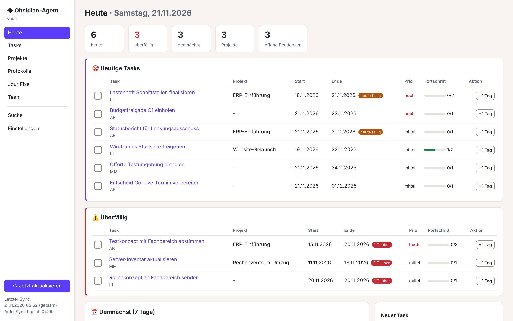
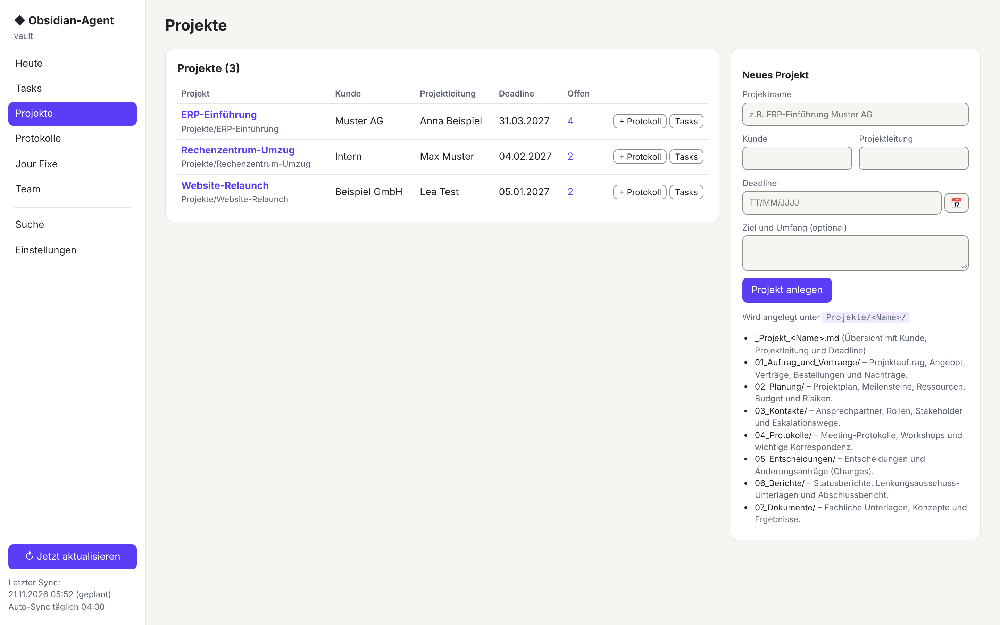
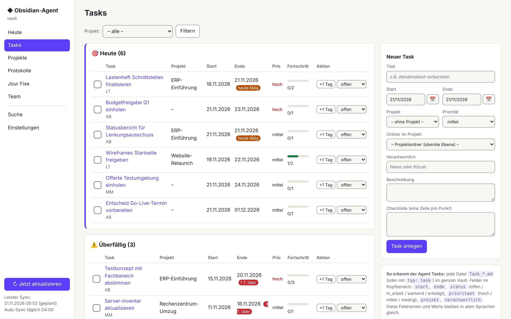
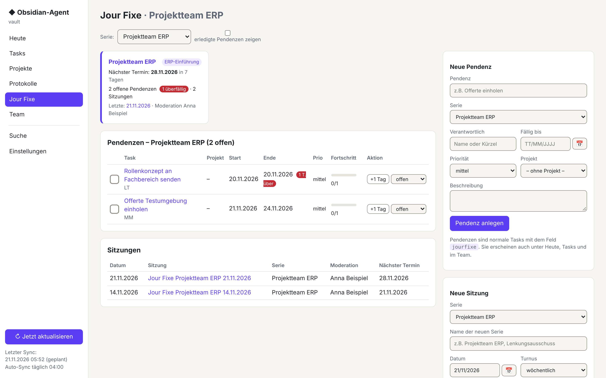
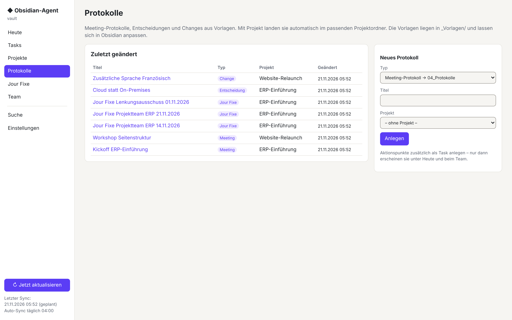
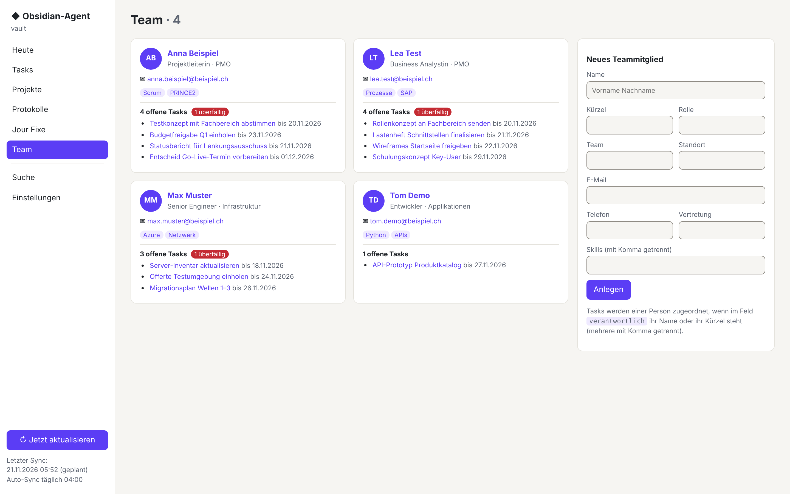
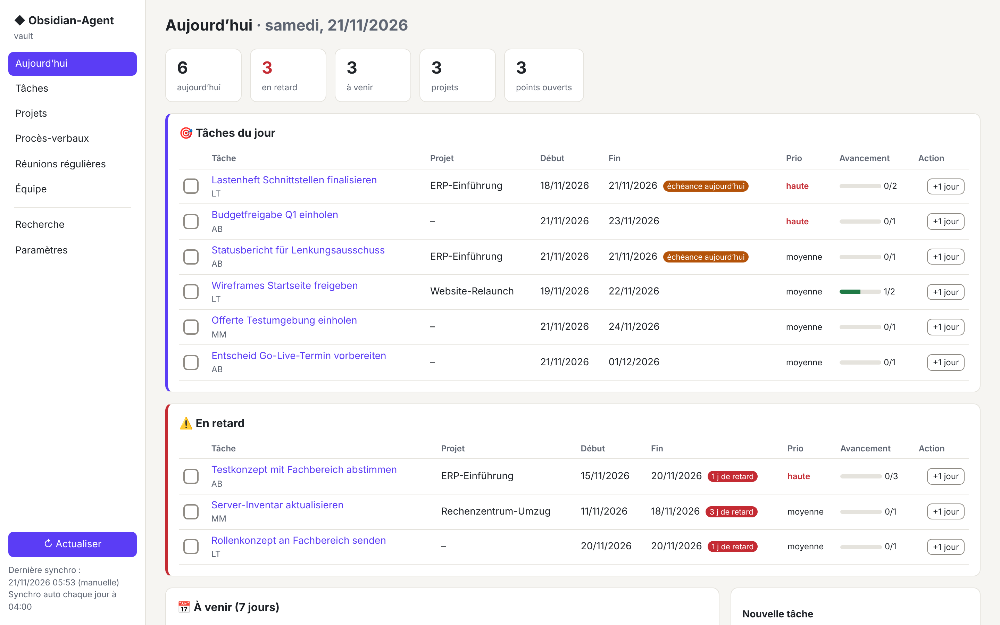

# ◆ Obsidian-Agent

**Deutsch** · [English](../readme_en.md) · [Español](../readme_es.md)

### Dein Obsidian-Vault wird zur Projektzentrale: Tasks, Projekte, Protokolle, Jour Fixes und Team auf einen Blick.

**Lokal. Ohne Cloud. Ohne Konto. Ohne Lock-in. Deine Notizen bleiben Markdown.**

`Windows` · `macOS` · `Linux` · `Python 3.10+` · `Läuft unter 127.0.0.1` · `🇩🇪 🇬🇧 🇫🇷 🇮🇹 🇪🇸 🇷🇴`

---

## Das Problem

Du führst Projekte, ein Team und eine Handvoll Gremien. Die Infos dazu liegen in Obsidian, aber verstreut: Aufgaben in Meeting-Notizen, Pendenzen im letzten Jour-Fixe-Protokoll, Deadlines im Kopf.

> *„Was ist heute fällig? Was ist überfällig? Was hat Lea noch offen – und was haben wir im letzten Lenkungsausschuss beschlossen?“*

Dataview & Co. zeigen dir das zwar an, aber nur, wenn Obsidian offen ist, nur so gut wie deine Abfragen, und ohne Formulare und ohne Verlauf.

## Die Lösung

Der **Obsidian-Agent** ist eine schlanke Weboberfläche, die neben Obsidian läuft. Er liest deinen Vault, zeigt dir den Tag und jedes Projekt auf einen Blick und legt neue Tasks, Protokolle und Sitzungsnotizen im richtigen Format an. Jeden Morgen um 04:00 schreibt er dir die Tagesübersicht, auch wenn Obsidian geschlossen ist.

| | |
|---|---|
| 👀 **Ein Blick genügt** | Heute fällig, überfällig, demnächst, nächste Jour Fixes – auf einer Seite. |
| 📄 **Markdown bleibt die Wahrheit** | Jede Aufgabe ist eine normale Notiz. Arbeite jederzeit direkt in Obsidian weiter. |
| 🔗 **Ein Klick führt in Obsidian** | Jeder Titel öffnet die Notiz sofort in Obsidian. |
| 🔒 **Bleibt auf deinem Rechner** | Keine Cloud, kein Konto, keine Telemetrie. Nur `127.0.0.1`. |
| 🌍 **Spricht deine Sprache** | Deutsch, English, Français, Italiano, Español, Română – umschaltbar in den Einstellungen. |
| ⚙️ **Läuft einfach** | Setup mit Doppelklick, Autostart bei der Anmeldung, Sync jede Nacht. |

---

## Funktionen

### 🎯 Heute: der Tag beginnt mit Klarheit

Alles, was heute ansteht, ganz oben. Darunter, was überfällig ist, was in den nächsten Tagen kommt und welche Jour Fixes anstehen. Abhaken mit einem Klick, verschieben mit „+1 Tag“, neuen Task direkt erfassen. Die Checkliste im Task zeigt den Fortschritt als Balken.

### 📁 Projekte: Ordnung ab dem ersten Klick

Ein neues Projekt bekommt sofort eine saubere Struktur: Auftrag & Verträge, Planung, Kontakte, Protokolle, Entscheidungen, Berichte, Dokumente – jeweils mit kurzer Readme. Die Übersicht zeigt Kunde, Projektleitung, Deadline und offene Tasks.

### ✅ Tasks: alles an einem Ort, nach Dringlichkeit sortiert

Heute, überfällig, geplant, ohne Datum, erledigt – mit Filter nach Projekt. Aufgaben, die du in Obsidian von Hand anlegst, erscheinen beim nächsten Sync automatisch.

### 🤝 Jour Fixe: keine Pendenz geht mehr verloren

Projektteam, Lenkungsausschuss, Abteilungsrunde: Jede Serie hat ihren Turnus, ihre Sitzungen und ihre Pendenzen. Jede neue Sitzungsnotiz enthält **automatisch alle offenen Pendenzen** der Serie. Pendenzen sind normale Tasks und tauchen auch unter Heute und beim Team auf.

### 📝 Protokolle: Meetings, Entscheidungen, Änderungsanträge

Ein Formular, eine Vorlage, der richtige Ordner: Meeting-Protokolle landen in *04_Protokolle*, Entscheidungen und Änderungsanträge in *05_Entscheidungen* des Projekts. Die Vorlagen passt du in Obsidian an, der Agent übernimmt sie.

### 👥 Team: wer macht was?

Personenkarten mit Rolle, Kontakt und Skills – und vor allem: die offenen und überfälligen Tasks jeder Person. Perfekt als Grundlage für das nächste 1:1.

### 🌍 Sechs Sprachen, ein Vault

Oberfläche, Vorlagen, Tagesübersicht und Installer gibt es auf Deutsch, Englisch, Französisch, Italienisch, Spanisch und Rumänisch. Die Feldnamen im Vault bleiben gleich – ein gemischtsprachiges Team arbeitet problemlos im selben Vault.

### Und ausserdem

- 🌙 **Dark Mode** automatisch nach Systemeinstellung, mit geprüften Kontrasten
- 🔎 **Volltextsuche** über den ganzen Vault
- 📱 **Tagesübersicht als Notiz** (`Planer/Heute.md`) – lesbar in Obsidian auf dem Handy
- 🗂 **Eigene Vorlagen und Ordnernamen** – alles in den Einstellungen anpassbar
- ⌨️ **Kommandozeile** für Sync, Tagesliste und neue Projekte

---

## Warum nicht einfach ein Plugin?

| | Obsidian-Plugins (z.B. Dataview) | **Obsidian-Agent** |
|---|:---:|:---:|
| Übersicht ohne offenes Obsidian | ❌ | ✅ |
| Formulare für Tasks, Projekte, Protokolle | ❌ | ✅ |
| Automatische Tagesübersicht um 04:00 | ❌ | ✅ |
| Verlauf: wer hat wann was erledigt | ❌ | ✅ |
| Jour-Fixe-Pendenzen automatisch im Protokoll | ❌ | ✅ |
| Notizen bleiben reines Markdown | ✅ | ✅ |

Der Agent **ersetzt Obsidian nicht, er ergänzt es.** Deine Dataview-Abfragen funktionieren weiter – jede Projektübersicht und jede Personennotiz bringt sogar fertige Abfragen mit.

---

## In 5 Minuten startklar

| Download | |
|---|---|
| 🪟 **Windows** | [Obsidian-Agent-Setup-2.0.0-Windows.zip](../Obsidian-Agent-Setup-2.0.0-Windows.zip) |
| 🍎 **macOS** | [Obsidian-Agent-Mac.zip](../Obsidian-Agent-Mac.zip) |

👉 Schritt für Schritt mit Bildern: [Kurzanleitung Installation](docs/installation.de.md) · 📚 [Alle Anleitungen und Sprachen](docs/README.md)

### Windows

1. ZIP herunterladen, entpacken und **`Obsidian-Agent-Setup.exe`** doppelklicken.
2. Der Setup-Assistent führt durch Sprache, Zielordner, Verknüpfungen und Vault – fertig.

Fehlt Python, installiert das Setup es automatisch. Keine Administratorrechte nötig.

### macOS

1. ZIP herunterladen, entpacken und **`Obsidian-Agent.pkg`** doppelklicken (beim ersten Mal: Rechtsklick → *Öffnen*).
2. Im Terminal-Fenster Sprache und Vault wählen – fertig.

Voraussetzung: Python 3.9 oder neuer (python.org).

### Danach

Öffne **[http://127.0.0.1:5055](http://127.0.0.1:5055)** und setz dir ein Lesezeichen. Der Agent startet ab jetzt bei jeder Anmeldung im Hintergrund.

👉 Ausführliche Anleitung: [Deutsch](docs/README.de.md) · [English](docs/README.en.md) · [Français](docs/README.fr.md) · [Italiano](docs/README.it.md) · [Español](docs/README.es.md) · [Română](docs/README.ro.md)

---

## Sicher und ohne Risiko

- 🔐 **Dein Vault gehört dir.** Der Agent schreibt nur neue Notizen und ändert Status oder Datum, wenn du es anklickst. Die Datenbank `planer.db` ist nur ein Index und jederzeit neu aufbaubar.
- 🧹 **Saubere Deinstallation.** Einstellungen und Datenbank werden auf den Desktop gesichert, der Vault bleibt unangetastet.
- 🔄 **Umzug ohne Stress.** Von Windows zum Mac oder auf einen neuen Rechner: installieren, zwei Dateien zurückkopieren, weiter geht’s.
- 👤 **Keine Administratorrechte.** Installation nur für dein Benutzerkonto, auch auf verwalteten Firmengeräten.
- 🛡 **Datenschutzfreundlich.** Personaldaten und Projektinfos verlassen deinen Rechner nicht (DSG/DSGVO).

---

**Weniger suchen. Mehr liefern.**

*Obsidian-Agent: Die Projektzentrale für deinen Vault.*

Screenshots zeigen fiktive Beispieldaten.
