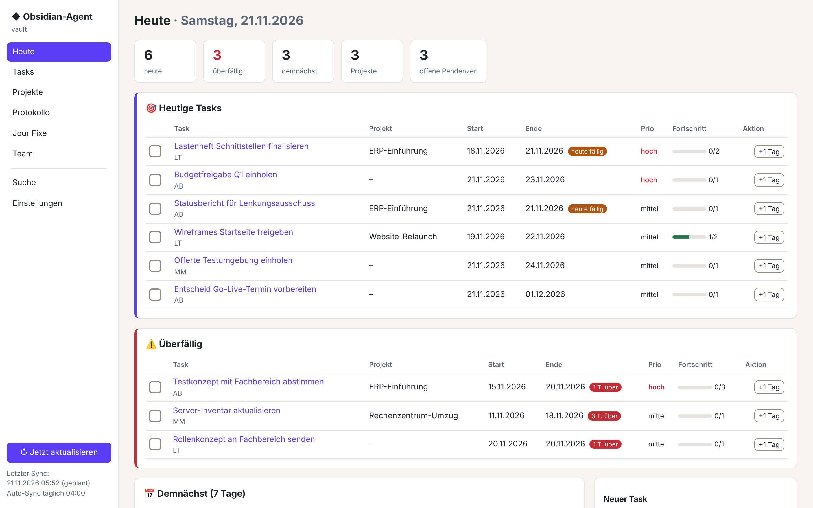
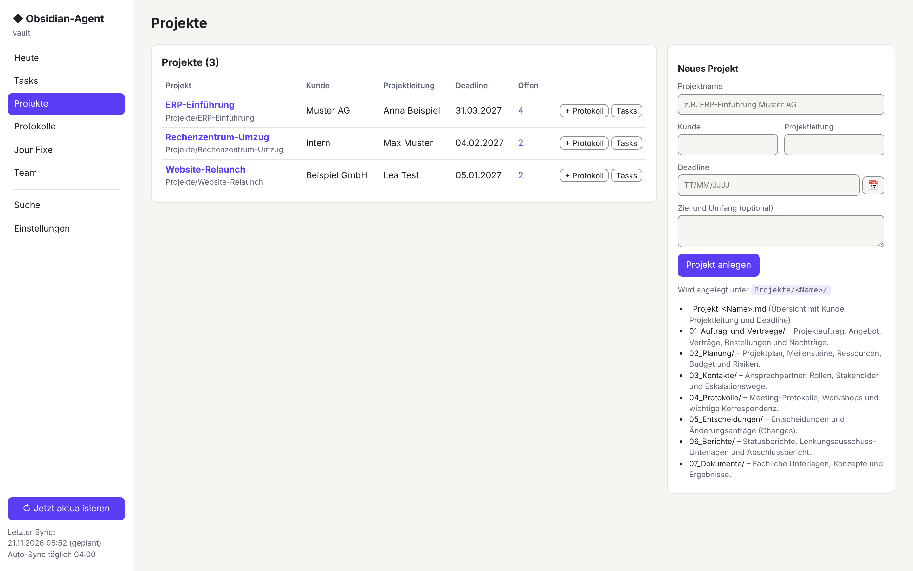
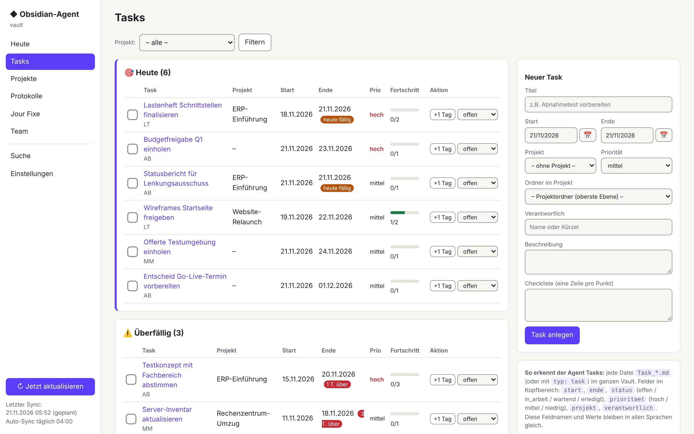
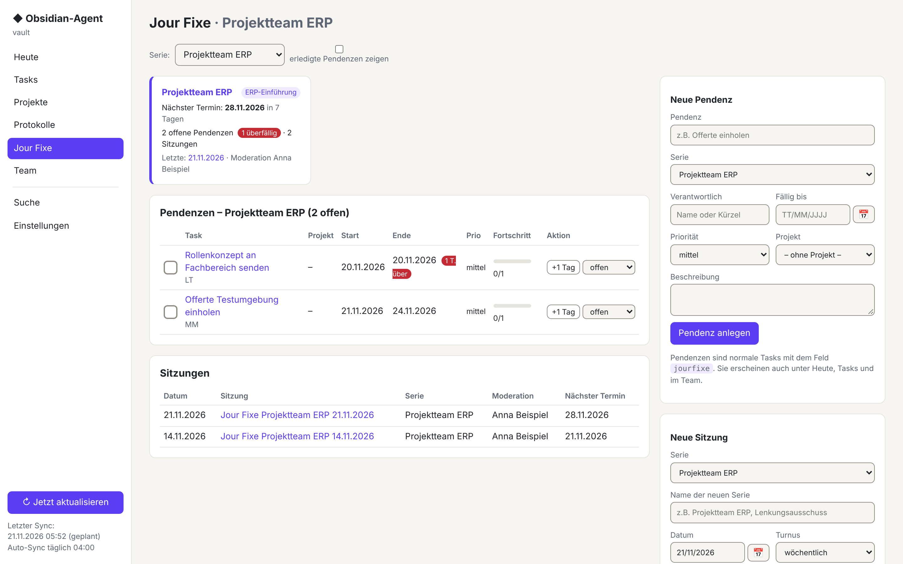
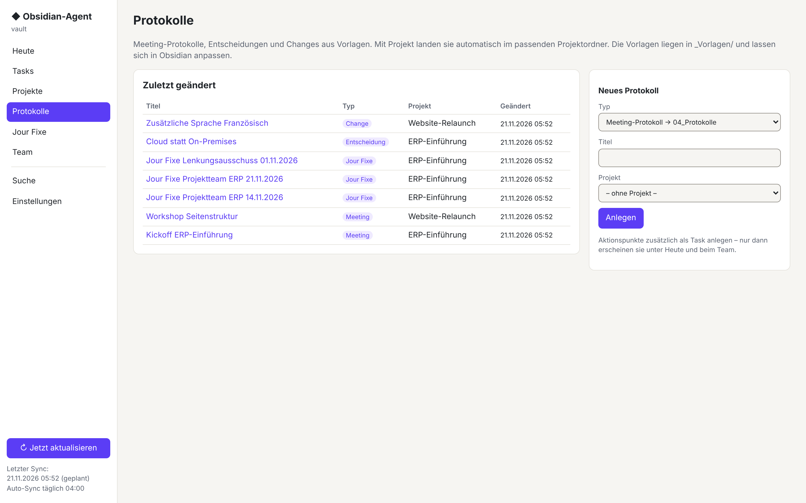
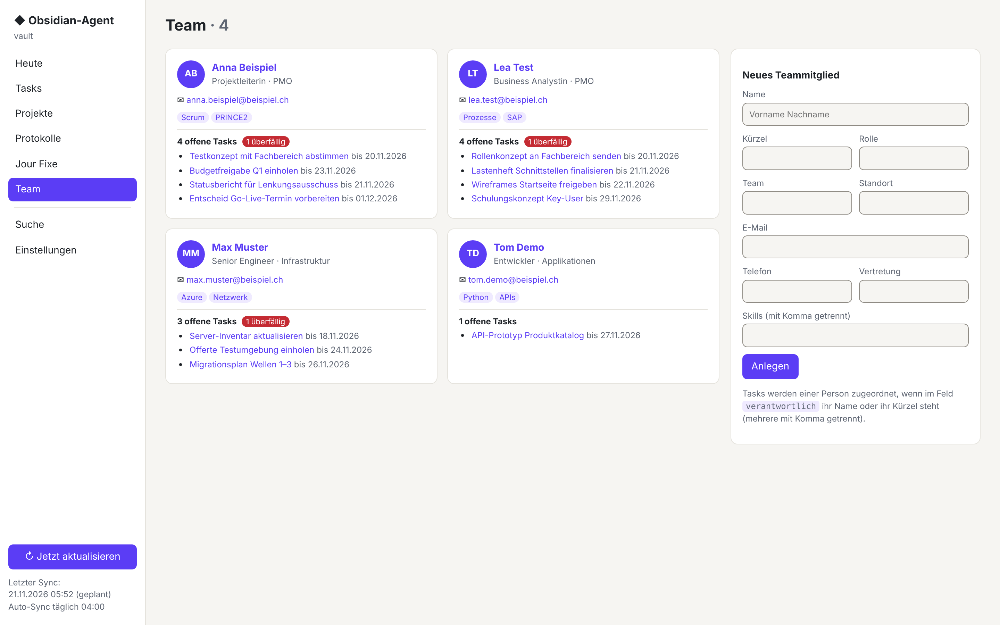
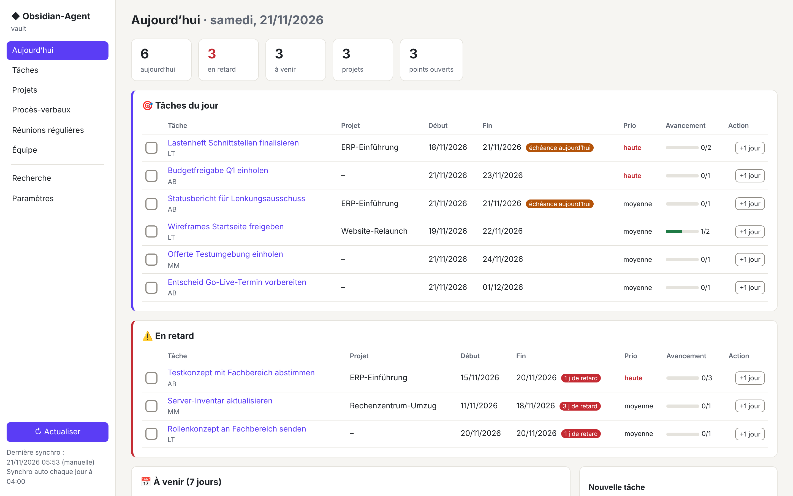

# ◆ Obsidian-Agent – Dokumentation · Documentation

[← Startseite / Home](../../README.md) · [English](../../readme_en.md) · [Español](../../readme_es.md)

Wähle deine Sprache · Choose your language · Choisissez votre langue · Scegliete la lingua · Elija su idioma · Alegeți limba

| | Sprache · Language | Installation (Kurz · Quick) | Anleitung · Guide |
|---|---|---|---|
| 🇩🇪 | **Deutsch** | [Kurzanleitung Installation](installation.de.md) | [Ausführliche Anleitung](README.de.md) |
| 🇬🇧 | **English** | [Quick installation guide](installation.en.md) | [Full guide](README.en.md) |
| 🇫🇷 | **Français** | [Guide d’installation rapide](installation.fr.md) | [Guide complet](README.fr.md) |
| 🇮🇹 | **Italiano** | [Guida rapida all’installazione](installation.it.md) | [Guida completa](README.it.md) |
| 🇪🇸 | **Español** | [Guía rápida de instalación](installation.es.md) | [Guía completa](README.es.md) |
| 🇷🇴 | **Română** | [Ghid rapid de instalare](installation.ro.md) | [Ghid complet](README.ro.md) |

## Setup-Assistent · Setup wizard

Schematische Darstellung · Schematic view

## Screenshots

| | |
|---|---|
|  |  |
| Heute · Today | Projekte · Projects |
|  |  |
| Tasks | Jour Fixe · Recurring meetings |
|  |  |
| Protokolle · Minutes | Team |
|  | |
| Interface en français | |

## Downloads

- 🪟 Windows: [Obsidian-Agent-Setup-2.0.0-Windows.zip](../../Obsidian-Agent-Setup-2.0.0-Windows.zip)
- 🍎 macOS: [Obsidian-Agent-Mac.zip](../../Obsidian-Agent-Mac.zip)

Screenshots zeigen fiktive Beispieldaten · Screenshots show fictitious sample data.
