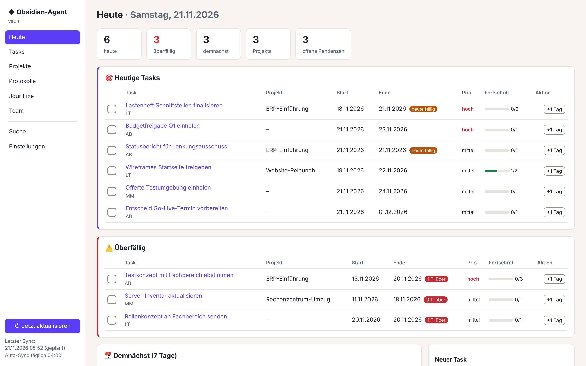
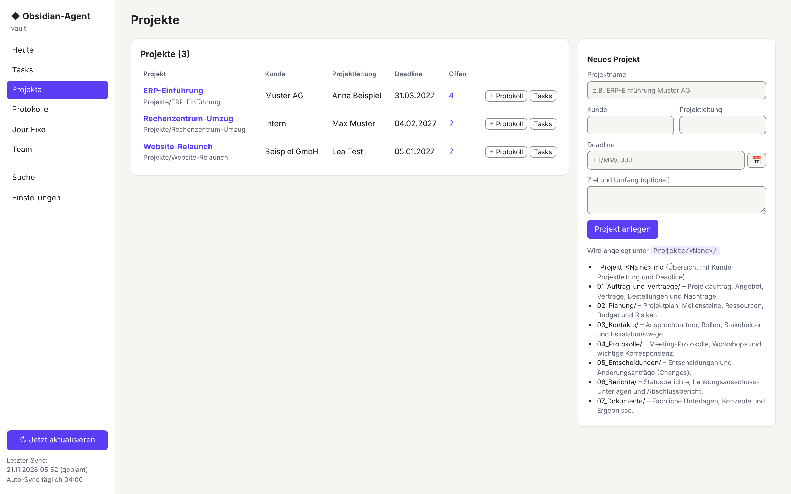
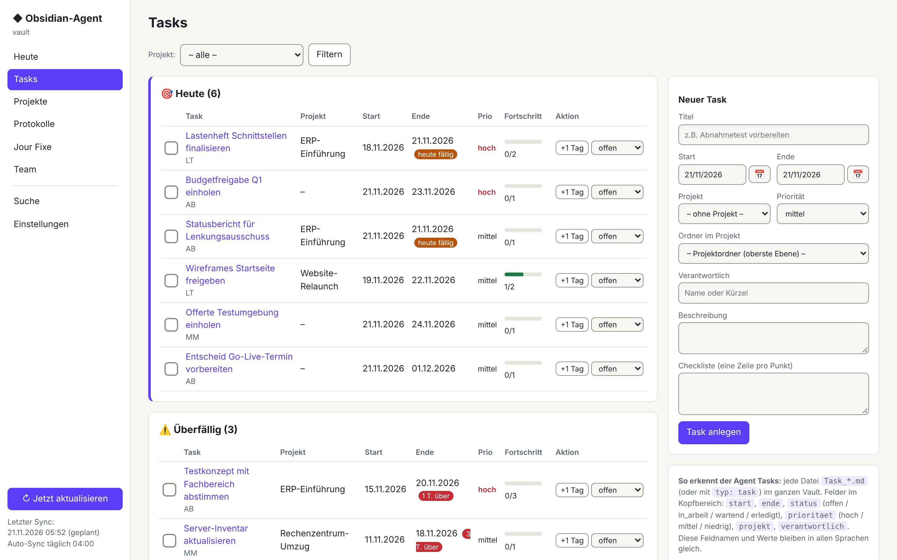
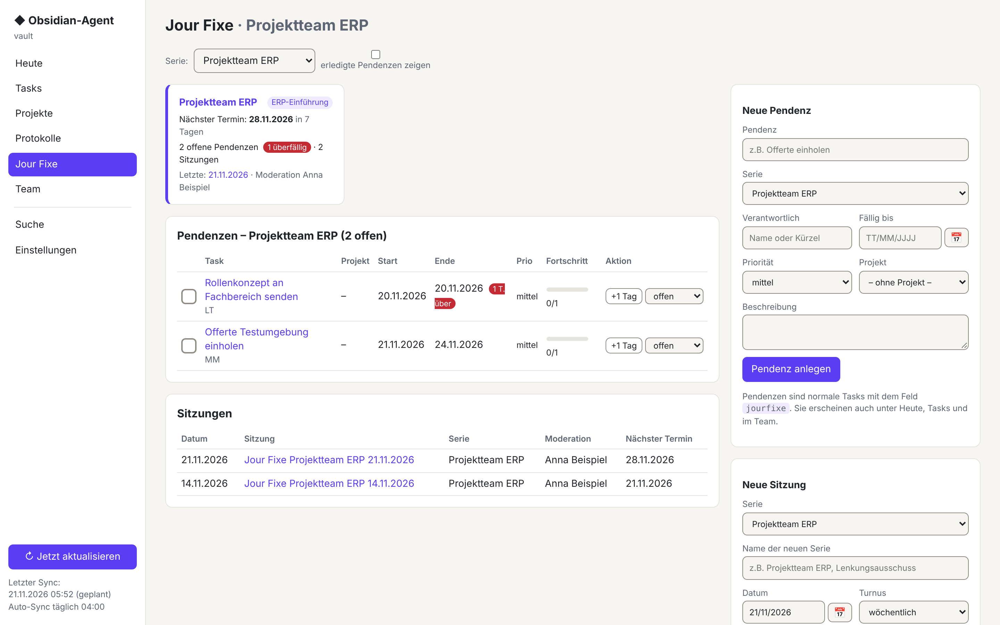
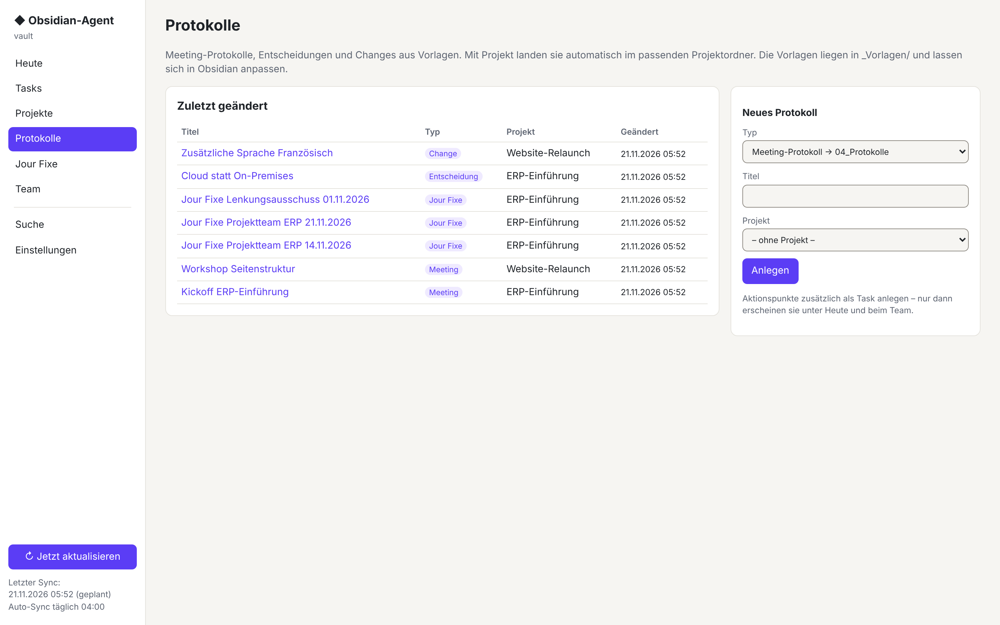
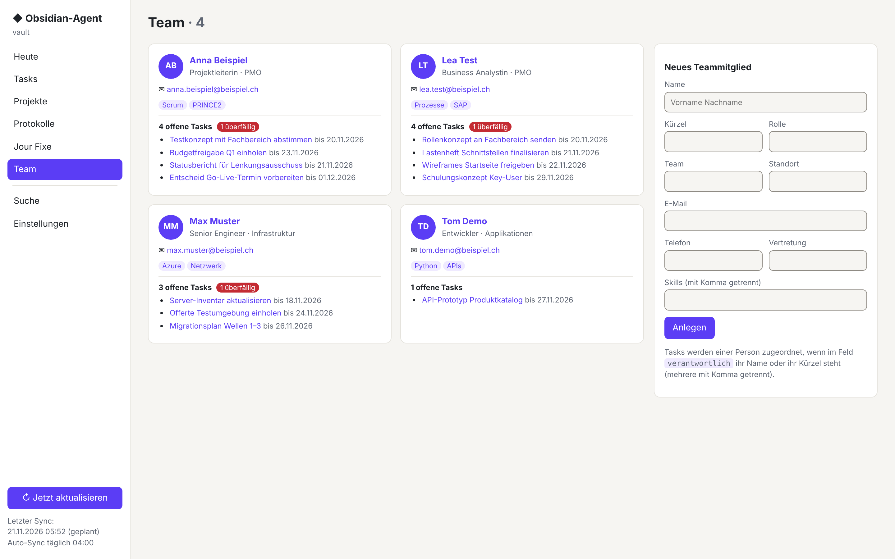
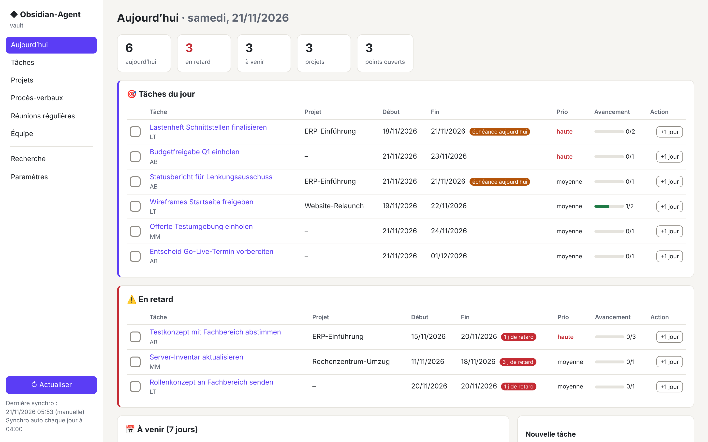

# ◆ Obsidian-Agent

[Deutsch](README.md) · **English** · [Español](readme_es.md)

### Turn your Obsidian vault into a project hub: tasks, projects, minutes, recurring meetings and your team at a glance.

**Local. No cloud. No account. No lock-in. Your notes stay Markdown.**

`Windows` · `macOS` · `Linux` · `Python 3.10+` · `Runs on 127.0.0.1` · `🇩🇪 🇬🇧 🇫🇷 🇮🇹 🇪🇸 🇷🇴`

---

## The problem

You run projects, a team and a handful of committees. The information lives in Obsidian, but it is scattered: tasks hidden in meeting notes, action items in the last meeting record, deadlines in your head.

> *“What’s due today? What’s overdue? What does Lea still have open – and what did the steering committee decide last time?”*

Dataview and friends can show you this, but only while Obsidian is open, only as good as your queries, and without forms or history.

## The solution

**Obsidian-Agent** is a lightweight web interface that runs alongside Obsidian. It reads your vault, shows your day and every project at a glance, and creates new tasks, minutes and meeting notes in the right format. Every morning at 04:00 it writes your daily overview – even when Obsidian is closed.

| | |
|---|---|
| 👀 **One glance is enough** | Due today, overdue, upcoming, next recurring meetings – on one page. |
| 📄 **Markdown stays the truth** | Every task is a normal note. Keep working directly in Obsidian at any time. |
| 🔗 **One click to Obsidian** | Every title opens the note straight in Obsidian. |
| 🔒 **Stays on your computer** | No cloud, no account, no telemetry. Just `127.0.0.1`. |
| 🌍 **Speaks your language** | Deutsch, English, Français, Italiano, Español, Română – switch in Settings. |
| ⚙️ **Just works** | Setup wizard, start at sign-in, sync every night. |

---

## Features

### 🎯 Today: start the day with clarity

Everything due today at the top. Below it: what’s overdue, what’s coming up and which recurring meetings are next. Tick off with one click, postpone with “+1 day”, capture a new task right there. A task’s checklist shows its progress as a bar.

### 📁 Projects: organised from the first click

A new project instantly gets a clean structure: mandate & contracts, planning, contacts, minutes, decisions, reports, documents – each with a short readme. The overview shows client, project lead, deadline and open tasks.

### ✅ Tasks: everything in one place, sorted by urgency

Today, overdue, planned, no date, done – filtered by project if you like. Tasks you create by hand in Obsidian show up automatically at the next sync.

### 🤝 Recurring meetings: no action item gets lost

Project team, steering committee, department meeting: every series has its frequency, its meetings and its action items. Each new meeting note **automatically lists all open action items** of the series. Action items are normal tasks and also appear under Today and in the team view.

### 📝 Minutes: meetings, decisions, change requests

One form, one template, the right folder: meeting minutes go into *04_Minutes*, decisions and change requests into *05_Decisions* of the project. Edit the templates in Obsidian and the agent uses them.

### 👥 Team: who is doing what?

Person cards with role, contact and skills – and above all, each person’s open and overdue tasks. The perfect basis for your next one-to-one.

### 🌍 Six languages, one vault

Interface, templates, daily overview and installers are available in German, English, French, Italian, Spanish and Romanian. Field names in the vault stay the same – a mixed-language team works happily in the same vault.

### And also

- 🌙 **Dark mode** following your system setting, with checked contrasts
- 🔎 **Full-text search** across the whole vault
- 📱 **Daily overview as a note** – readable in Obsidian on your phone
- 🗂 **Your own templates and folder names** – all adjustable in Settings
- ⌨️ **Command line** for sync, daily list and new projects

---

## Why not just a plugin?

| | Obsidian plugins (e.g. Dataview) | **Obsidian-Agent** |
|---|:---:|:---:|
| Overview without Obsidian open | ❌ | ✅ |
| Forms for tasks, projects, minutes | ❌ | ✅ |
| Automatic daily overview at 04:00 | ❌ | ✅ |
| History: who finished what and when | ❌ | ✅ |
| Open action items added to meeting notes automatically | ❌ | ✅ |
| Notes stay plain Markdown | ✅ | ✅ |

The agent **doesn’t replace Obsidian, it complements it.** Your Dataview queries keep working – every project overview and person note even comes with ready-made queries.

---

## Up and running in 5 minutes

| Download | |
|---|---|
| 🪟 **Windows** | [Obsidian-Agent-Setup-2.0.0-Windows.zip](Obsidian-Agent-Setup-2.0.0-Windows.zip) |
| 🍎 **macOS** | [Obsidian-Agent-Mac.zip](Obsidian-Agent-Mac.zip) |

👉 Step by step with pictures: [Quick installation guide](obsidian-agent-readme/docs/installation.en.md) · 📚 [All guides and languages](obsidian-agent-readme/docs/README.md)

### Windows

1. Download the ZIP, extract it and double-click **`Obsidian-Agent-Setup.exe`**.
2. The setup wizard guides you through language, install folder, shortcuts and vault – done.

If Python is missing, setup installs it automatically. No administrator rights needed.

### macOS

1. Download the ZIP, extract it and double-click **`Obsidian-Agent.pkg`** (first time: right-click → *Open*).
2. Choose language and vault in the Terminal window – done.

Requirement: Python 3.9 or newer (python.org).

### Then

Open **[http://127.0.0.1:5055](http://127.0.0.1:5055)** and bookmark it. From now on the agent starts in the background every time you sign in.

👉 Full guide: [Deutsch](obsidian-agent-readme/docs/README.de.md) · [English](obsidian-agent-readme/docs/README.en.md) · [Français](obsidian-agent-readme/docs/README.fr.md) · [Italiano](obsidian-agent-readme/docs/README.it.md) · [Español](obsidian-agent-readme/docs/README.es.md) · [Română](obsidian-agent-readme/docs/README.ro.md)

---

## Safe and risk-free

- 🔐 **Your vault belongs to you.** The agent only writes new notes and changes status or dates when you click. The database `planer.db` is just an index and can be rebuilt at any time.
- 🧹 **Clean uninstall.** Settings and database are backed up to the desktop; the vault is left untouched.
- 🔄 **Move without stress.** From Windows to Mac or to a new computer: install, copy two files back, carry on.
- 👤 **No administrator rights.** Installs for your user account only, even on managed company devices.
- 🛡 **Privacy-friendly.** Personal data and project information never leave your computer (GDPR).

---

**Search less. Deliver more.**

*Obsidian-Agent: the project hub for your vault.*

Screenshots show fictitious sample data.
