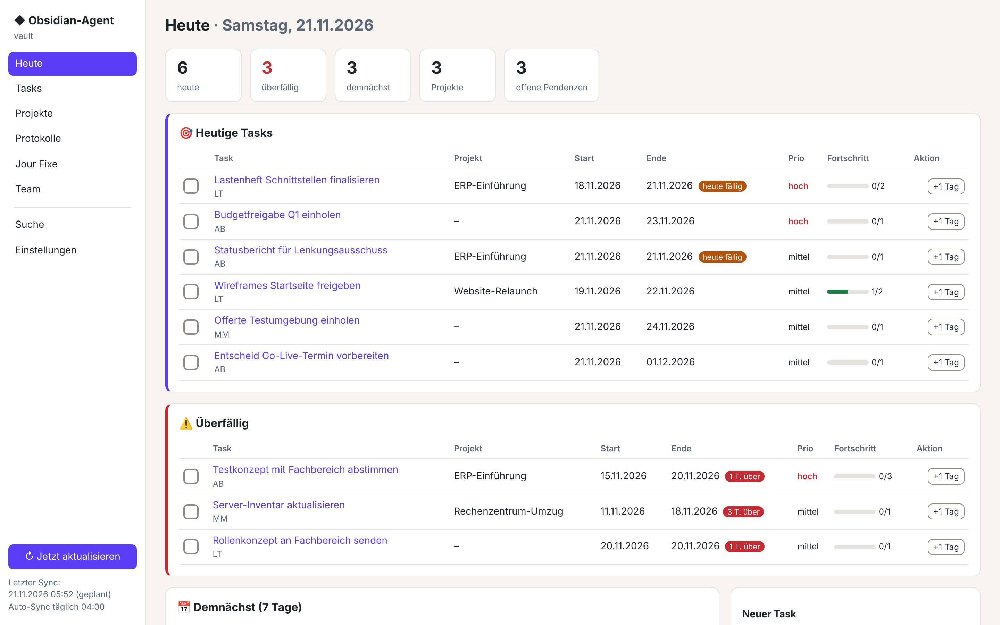
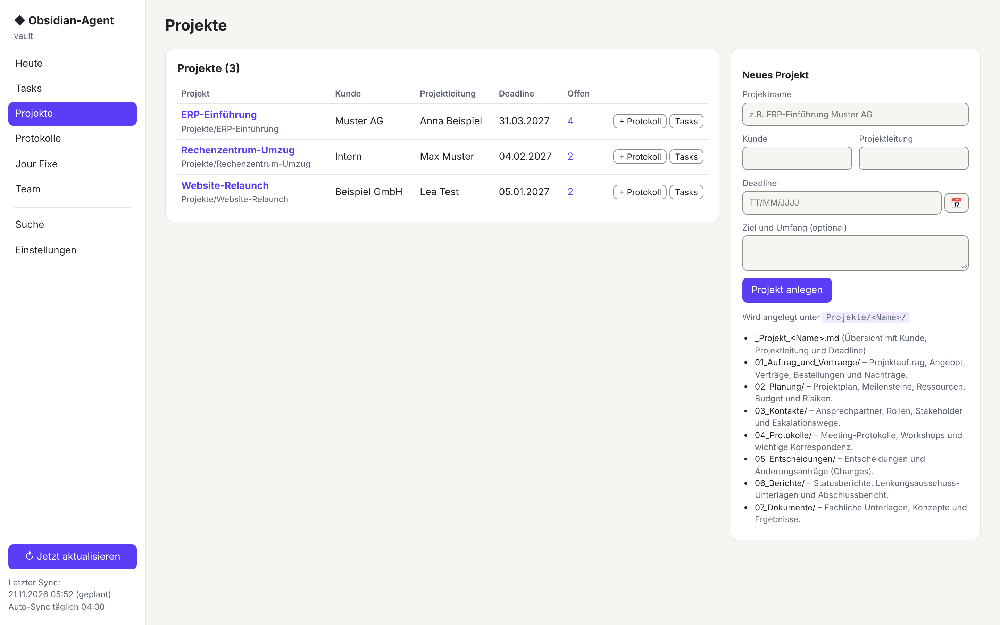
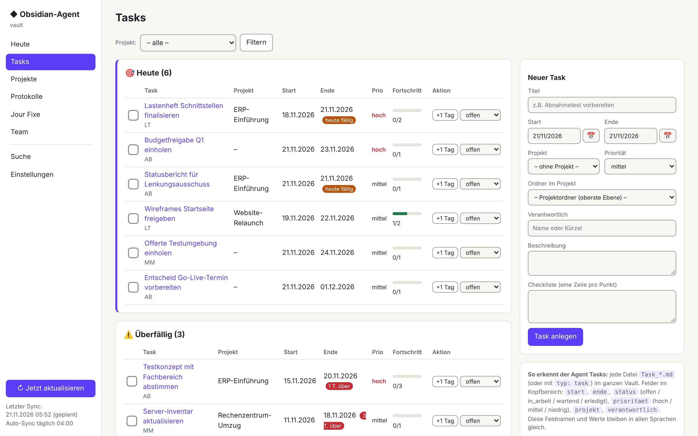
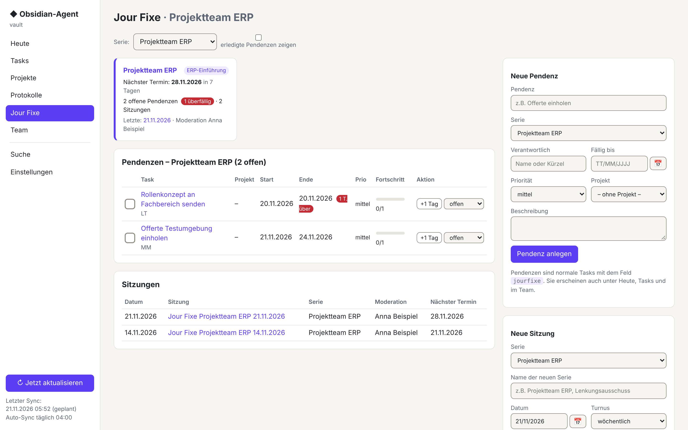
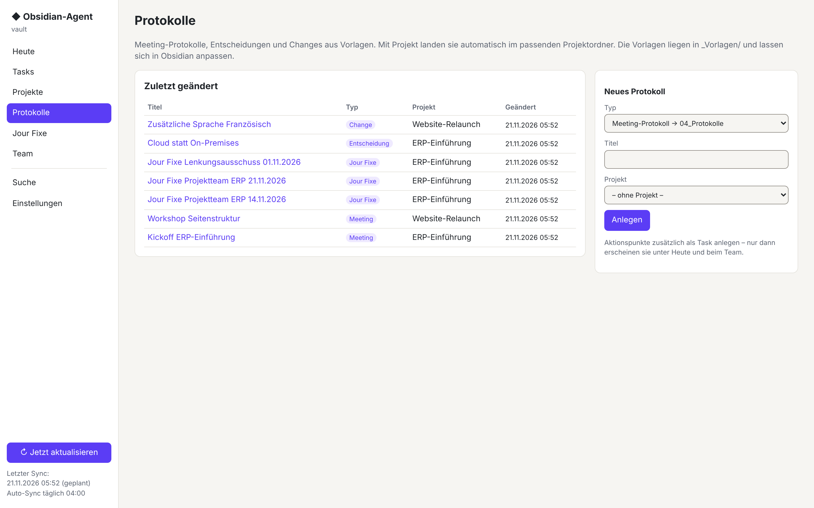
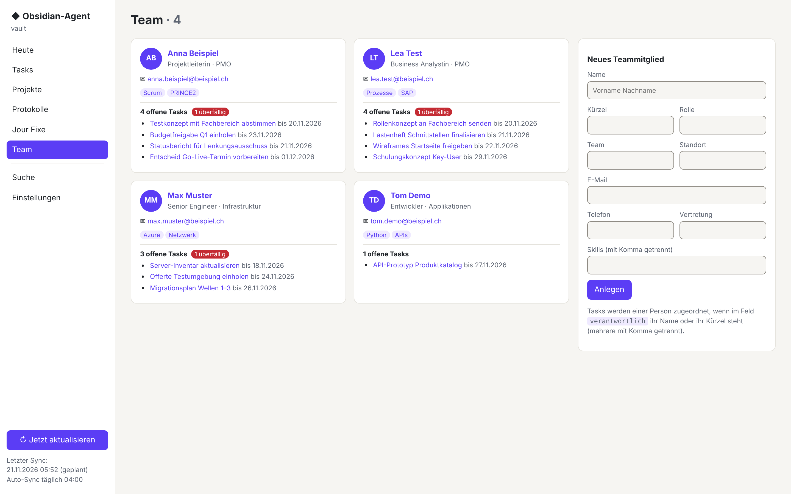
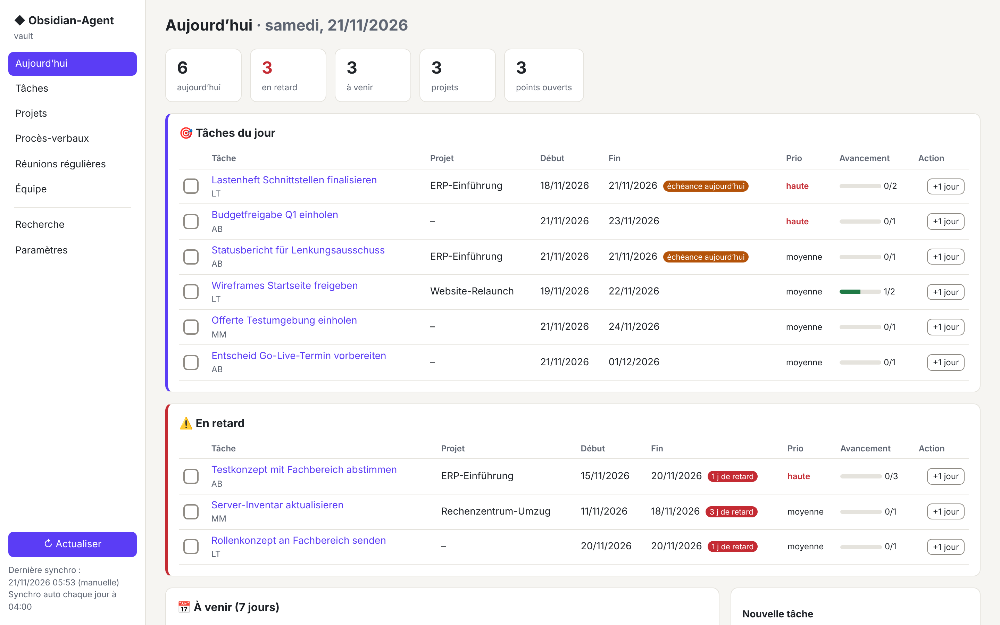

# ◆ Obsidian-Agent

[Deutsch](README.md) · [English](readme_en.md) · **Español**

### Convierta su almacén de Obsidian en el centro de sus proyectos: tareas, proyectos, actas, reuniones periódicas y su equipo de un vistazo.

**Local. Sin nube. Sin cuenta. Sin dependencias. Sus notas siguen siendo Markdown.**

`Windows` · `macOS` · `Linux` · `Python 3.10+` · `Funciona en 127.0.0.1` · `🇩🇪 🇬🇧 🇫🇷 🇮🇹 🇪🇸 🇷🇴`

---

## El problema

Dirige proyectos, un equipo y varios comités. La información está en Obsidian, pero dispersa: tareas escondidas en notas de reuniones, puntos abiertos en la última acta, fechas límite en la cabeza.

> *«¿Qué vence hoy? ¿Qué está vencido? ¿Qué le queda pendiente a Lea… y qué decidió el comité de dirección la última vez?»*

Dataview y otros plugins pueden mostrarlo, pero solo con Obsidian abierto, solo tan bien como sus consultas, y sin formularios ni historial.

## La solución

**Obsidian-Agent** es una interfaz web ligera que funciona junto a Obsidian. Lee su almacén, muestra su día y cada proyecto de un vistazo y crea tareas, actas y notas de reunión en el formato correcto. Cada mañana a las 04:00 escribe su resumen diario, incluso con Obsidian cerrado.

| | |
|---|---|
| 👀 **Basta un vistazo** | Lo que vence hoy, lo vencido, lo próximo y las siguientes reuniones periódicas, en una sola página. |
| 📄 **Markdown sigue siendo la verdad** | Cada tarea es una nota normal. Siga trabajando directamente en Obsidian cuando quiera. |
| 🔗 **Un clic lleva a Obsidian** | Cada título abre la nota directamente en Obsidian. |
| 🔒 **Se queda en su equipo** | Sin nube, sin cuenta, sin telemetría. Solo `127.0.0.1`. |
| 🌍 **Habla su idioma** | Deutsch, English, Français, Italiano, Español, Română; se cambia en Ajustes. |
| ⚙️ **Funciona sin más** | Asistente de instalación, inicio al iniciar sesión, sincronización cada noche. |

---

## Funciones

### 🎯 Hoy: el día empieza con claridad

Todo lo que vence hoy, arriba. Debajo: lo vencido, lo que llega en los próximos días y las siguientes reuniones periódicas. Marcar con un clic, aplazar con «+1 día», crear una tarea nueva ahí mismo. La lista de control de cada tarea muestra el avance como barra.

### 📁 Proyectos: orden desde el primer clic

Un proyecto nuevo recibe al instante una estructura limpia: encargo y contratos, planificación, contactos, actas, decisiones, informes, documentos, cada uno con un breve readme. El resumen muestra cliente, jefe de proyecto, fecha límite y tareas abiertas.

### ✅ Tareas: todo en un lugar, ordenado por urgencia

Hoy, vencidas, planificadas, sin fecha, hechas, con filtro por proyecto. Las tareas que cree a mano en Obsidian aparecen automáticamente en la siguiente sincronización.

### 🤝 Reuniones periódicas: ningún punto abierto se pierde

Equipo de proyecto, comité de dirección, reunión de departamento: cada serie tiene su frecuencia, sus reuniones y sus puntos abiertos. Cada nueva nota de reunión **incluye automáticamente todos los puntos abiertos** de la serie. Los puntos abiertos son tareas normales y aparecen también en Hoy y en la vista del equipo.

### 📝 Actas: reuniones, decisiones, solicitudes de cambio

Un formulario, una plantilla, la carpeta correcta: las actas van a *04_Actas*, las decisiones y solicitudes de cambio a *05_Decisiones* del proyecto. Edite las plantillas en Obsidian y el agente las utiliza.

### 👥 Equipo: ¿quién hace qué?

Fichas con función, contacto y competencias y, sobre todo, las tareas abiertas y vencidas de cada persona. La base perfecta para su próxima reunión individual.

### 🌍 Seis idiomas, un almacén

Interfaz, plantillas, resumen diario e instaladores en alemán, inglés, francés, italiano, español y rumano. Los nombres de campo del almacén no cambian: un equipo multilingüe trabaja sin problemas en el mismo almacén.

### Y además

- 🌙 **Modo oscuro** según el sistema, con contrastes comprobados
- 🔎 **Búsqueda de texto completo** en todo el almacén
- 📱 **Resumen diario como nota**, legible en Obsidian en el móvil
- 🗂 **Plantillas y nombres de carpeta propios**, todo ajustable en Ajustes
- ⌨️ **Línea de comandos** para sincronizar, ver el día y crear proyectos

---

## ¿Por qué no simplemente un plugin?

| | Plugins de Obsidian (p. ej. Dataview) | **Obsidian-Agent** |
|---|:---:|:---:|
| Resumen sin Obsidian abierto | ❌ | ✅ |
| Formularios para tareas, proyectos y actas | ❌ | ✅ |
| Resumen diario automático a las 04:00 | ❌ | ✅ |
| Historial: quién terminó qué y cuándo | ❌ | ✅ |
| Puntos abiertos añadidos automáticamente al acta | ❌ | ✅ |
| Las notas siguen siendo Markdown puro | ✅ | ✅ |

El agente **no sustituye a Obsidian, lo complementa.** Sus consultas de Dataview siguen funcionando; cada resumen de proyecto y cada nota de persona incluso trae consultas ya preparadas.

---

## Listo en 5 minutos

| Descarga | |
|---|---|
| 🪟 **Windows** | [Obsidian-Agent-Setup-2.0.0-Windows.zip](Obsidian-Agent-Setup-2.0.0-Windows.zip) |
| 🍎 **macOS** | [Obsidian-Agent-Mac.zip](Obsidian-Agent-Mac.zip) |

👉 Paso a paso con imágenes: [Guía rápida de instalación](obsidian-agent-readme/docs/installation.es.md) · 📚 [Todas las guías e idiomas](obsidian-agent-readme/docs/README.md)

### Windows

1. Descargue el ZIP, descomprímalo y haga doble clic en **`Obsidian-Agent-Setup.exe`**.
2. El asistente le guía por idioma, carpeta de instalación, accesos directos y almacén. Listo.

Si falta Python, el instalador lo instala automáticamente. No se necesitan derechos de administrador.

### macOS

1. Descargue el ZIP, descomprímalo y haga doble clic en **`Obsidian-Agent.pkg`** (la primera vez: clic derecho → *Abrir*).
2. Elija idioma y almacén en la ventana de Terminal. Listo.

Requisito: Python 3.9 o posterior (python.org).

### Después

Abra **[http://127.0.0.1:5055](http://127.0.0.1:5055)** y guárdela como marcador. A partir de ahora el agente se inicia en segundo plano cada vez que inicia sesión.

👉 Guía completa: [Deutsch](obsidian-agent-readme/docs/README.de.md) · [English](obsidian-agent-readme/docs/README.en.md) · [Français](obsidian-agent-readme/docs/README.fr.md) · [Italiano](obsidian-agent-readme/docs/README.it.md) · [Español](obsidian-agent-readme/docs/README.es.md) · [Română](obsidian-agent-readme/docs/README.ro.md)

---

## Seguro y sin riesgos

- 🔐 **Su almacén le pertenece.** El agente solo escribe notas nuevas y cambia estado o fechas cuando usted hace clic. La base de datos `planer.db` es solo un índice y puede reconstruirse en cualquier momento.
- 🧹 **Desinstalación limpia.** Ajustes y base de datos se guardan en el escritorio; el almacén no se toca.
- 🔄 **Traslado sin estrés.** De Windows a Mac o a un equipo nuevo: instalar, copiar dos archivos y seguir.
- 👤 **Sin derechos de administrador.** Se instala solo para su cuenta de usuario, también en equipos gestionados de la empresa.
- 🛡 **Respetuoso con la privacidad.** Los datos personales y de proyectos no salen de su equipo (RGPD).

---

**Buscar menos. Entregar más.**

*Obsidian-Agent: el centro de proyectos para su almacén.*

Las capturas muestran datos de ejemplo ficticios.
